# Selected Academic Projects

**Gabriel Trabelsi**

M2 IASD · Université Paris Dauphine-PSL

[Download the illustrated PDF](portfolio.pdf)

From statistical methods to Python implementations and experimental analysis. This portfolio brings together existing coursework on sensor-based regression, Monte-Carlo simulation, Bayesian inference and latent-variable estimation.

| Focus | Evidence in the portfolio |
| --- | --- |
| Learning from data | Cleaning, temporal structure, regression baselines, kernels, neural networks and residual analysis. |
| Computational inference | Simulation, importance weights, Metropolis/MALA and the E-step/M-step of Gaussian-mixture EM. |
| Scientific interpretation | Sensitivity to hyperparameters, initialization, data size and modelling assumptions. |

### Reading path

Air Quality: pages 2-4. Simulation and rare events: page 5. Bayesian sampling: page 6. EM: page 7. Code, provenance and reproduction: page 8.

A presentation edition of completed academic work. Figures and numerical results are retained from the original notebooks; model limitations are stated alongside the observations.

[github.com/Frodogorn/statistical-learning-portfolio](https://github.com/Frodogorn/statistical-learning-portfolio)

## Air-quality estimation

### Problem and data

Estimate CO, benzene, NOx and NO2 reference concentrations from five sensor responses and temperature, relative humidity and absolute humidity. This is contemporaneous sensor-based estimation, with a chronological evaluation split.

The local CSV contains 9,357 dated observations. Missing values encoded as -200 are replaced, the mostly missing NMHC reference variable is removed, and complete-case filtering retains **6,941 observations**. The original split uses **5,552 training rows and 1,389 later evaluation rows**.

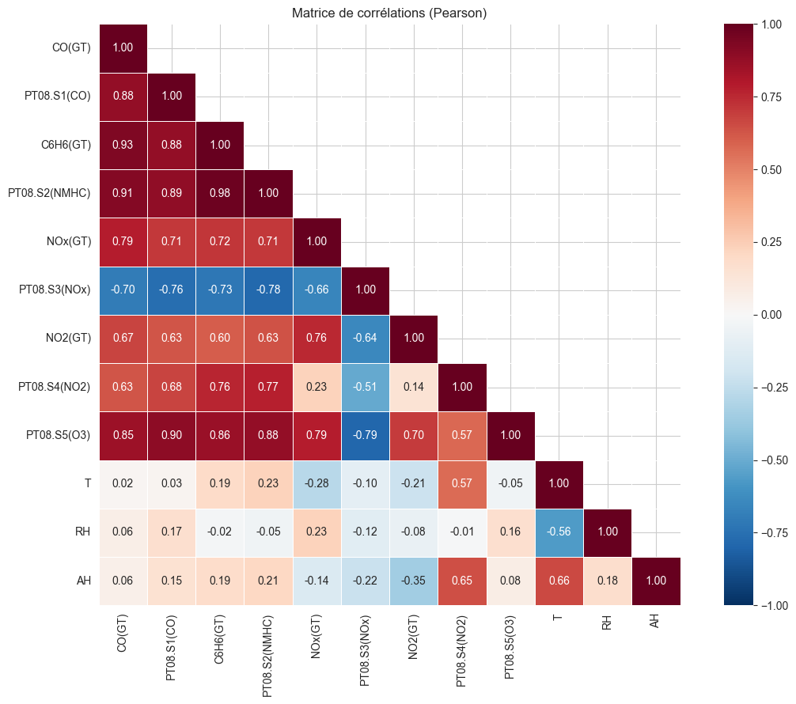

*Figure 1. Correlations from the original exploratory analysis. Correlated sensor responses complicate coefficient interpretation.*

### Implemented workflow

Distribution plots and temporal profiles lead into standardized linear baselines, ridge regression, RBF kernel ridge regression and dense neural networks. The analysis then inspects prediction errors, permutation importance and Kernel SHAP.

Dataset: Vito, S. (2008), Air Quality, UCI Machine Learning Repository. DOI: 10.24432/C59K5F. The project retains the dataset source and its separate terms.

## Comparing the fitted models

### Recorded R² on the chronological evaluation partition

| Target | OLS, 8 inputs | Ridge | RBF kernel | MLP (64,32) |
| --- | --- | --- | --- | --- |
| CO | 0.8605 | 0.8605 | 0.8769 | 0.8258 |
| Benzene | 0.9429 | 0.9429 | 0.9999 | 0.9986 |
| NOx | 0.8336 | 0.8339 | 0.8838 | 0.8961 |
| NO2 | 0.5018 | 0.5019 | 0.5606 | 0.6075 |

Values are transcribed from the saved numerical outputs. The MLP column uses one fixed architecture and original settings, rather than a different winning architecture for each target. The final partition was reused for exploratory comparisons, so these are not independent final benchmark scores.

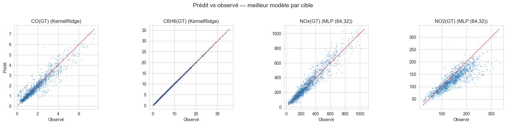

*Figure 2. Selected predicted-versus-observed plots. The original display uses kernel models for CO/benzene and MLP models for NOx/NO2.*

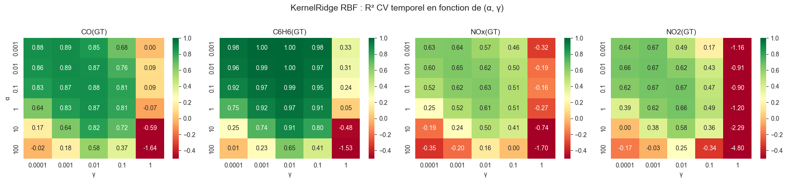

*Figure 3. An existing kernel hyperparameter sweep. The heatmap is a separate grid from the search reported in the table.*

### Observation

Predictive difficulty varies markedly across targets. The benzene fit is nearly deterministic in this dataset, while NO2 remains harder to estimate. This comparison motivates inspection of errors and the experimental protocol, rather than a single headline score.

## Temporal structure and errors

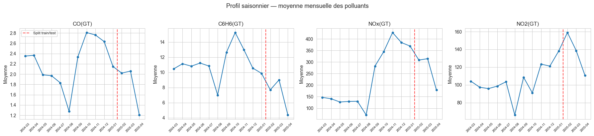

*Figure 4. Monthly concentration profiles in the cleaned data.*

### Existing hour-of-day experiment

The notebook adds sine/cosine encodings of hour to the NO2 predictors. For the same MLP configuration, the recorded R² changes from **0.6698 to 0.7049**, a gain of 0.0351. This is an exploratory comparison following a hyperparameter sweep on the same evaluation partition.

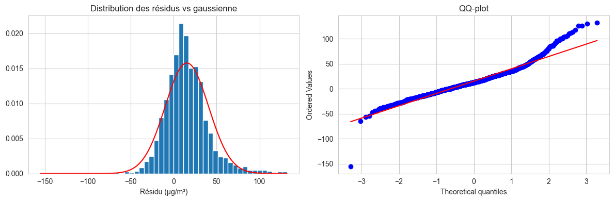

*Figure 5. NO2 residuals from the separate, deeper network with augmented inputs. These are not the residuals of every MLP in the comparison table.*

### Interpretation and protocol

The stored residual diagnostics show a positive mean error and a heavy right tail. This supports inspecting underestimation of high concentrations. Correlation and feature attribution remain descriptive: they do not establish a causal sensor effect or automatically separate correlated inputs.

The outer scaler is fitted on training data, but before inner cross-validation. RidgeCV and MLP early stopping also use their default internal validation schemes. A future independent benchmark would isolate preprocessing within folds and reserve an untouched final test set; the current edition preserves the original experiment.

## Simulation and rare events

### From a distribution to a simulator

The simulation notebook implements repeated Bernoulli trials, inverse transforms, Box-Muller, Marsaglia polar sampling and a Cholesky transform for correlated Gaussian vectors. Its saved timings are illustrative individual runs; the Box-Muller and SciPy timing cells generate different numbers of output values.

### When direct Monte-Carlo misses the event

| Gaussian tail P(Z ≥ 6) | Saved value |
| --- | --- |
| Analytical reference | 9.865876450376948e-10 |
| Direct Monte-Carlo, 100 million draws | 0 |
| Shifted exponential, 500,000 draws | 9.865407869402759e-10 |

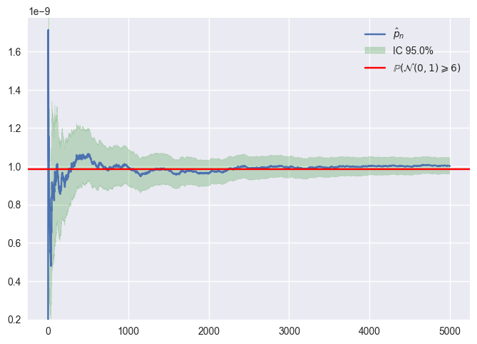

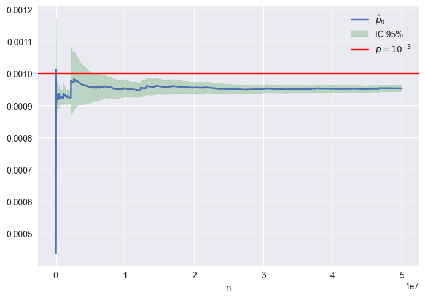

*Figures 6-7. Running importance-sampling estimates for a Gaussian tail (left) and a Pareto tail (right).*

### A proposal can also fail

The Pareto example uses a light-tailed exponential proposal. The saved run records a maximum-to-average weight ratio above **120,000**. Large weights can dominate the estimate, so the displayed normal-approximation interval should not be treated as validated uncertainty. These are existing individual experiments, not repeated-run coverage studies.

## Bayesian updates and sampling

### A conjugate reference example

For a standard normal prior and Gaussian observations with unit variance, the completed integration example plots posterior densities after 3, 5 and 10 observations. It also computes the posterior mean, providing a simple reference for Bayesian estimation.

### Two Gaussian-target samplers

Random-walk Metropolis proposes a symmetric uniform increment and applies the target-density ratio. MALA uses the Gaussian log-density gradient to move toward the central region, then corrects for the asymmetric proposal. The functions return samples and acceptance rates.

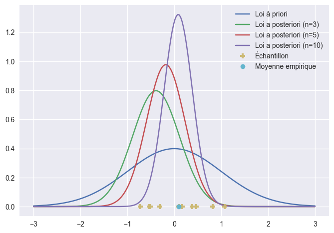

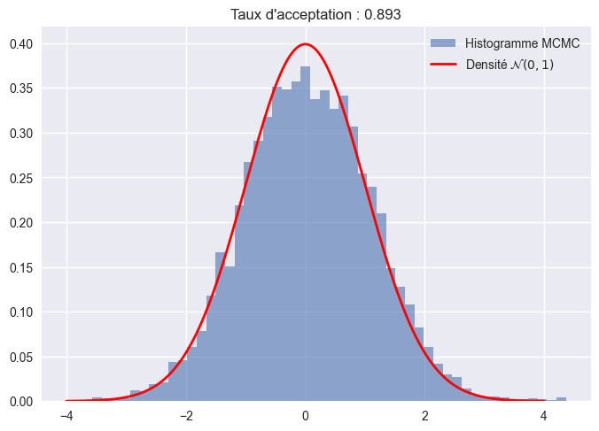

*Figures 8-9. Conjugate Gaussian posterior updates (left) and a Metropolis Gaussian-target histogram (right), from the original notebooks.*

### What is demonstrated

The completed code makes proposal construction, acceptance logic and the effect of initialization explicit. An additional section retains the original posterior-sampling implementation for a mixture weight, with its inconsistent historical outputs omitted.

### What is not established

Marginal histograms and acceptance rates are limited diagnostics. The original work does not report effective sample size, multi-chain convergence checks or a computation-normalized comparison. Direct evaluation of small densities can also cause underflow.

## Latent-variable estimation with EM

### Implemented model

A two-component univariate Gaussian mixture is fitted by alternating responsibilities and weighted parameter updates. The code estimates the mixture weight, both means and separate component variances. The original simulation uses means -2 and 3, standard deviations 1.5 and 1, and weight 0.3.

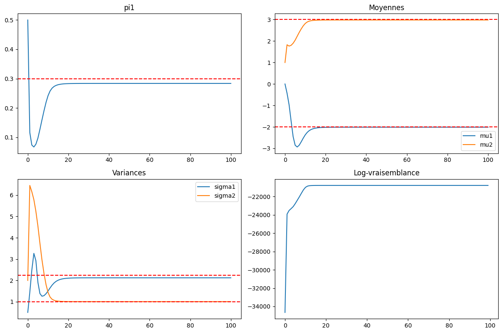

*Figure 10. Original parameter trajectories and observed log-likelihood.*

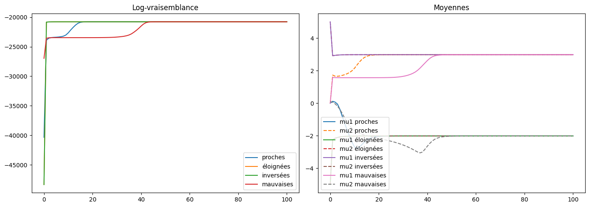

*Figure 11. Existing initialization experiment on the same sample.*

### Existing sensitivity experiments

A reusable EM function supports changes in initialization, iteration count and sample size. Another experiment deliberately fits two components to data generated from three groups. These examples expose sensitivity and model misspecification; a likelihood plateau alone does not establish a globally optimal or appropriate fit.

Implementation limits: fixed iteration budgets, direct density calculations and no variance floor. Sample-size comparisons use one new sample per size.

## Inspecting and reproducing the work

### Notebook guide

| Notebook | Content |
| --- | --- |
| 01_air_quality | Exploratory analysis, regressors, interpretation and residuals. |
| 02_random_variable_simulation | Geometric and Gaussian simulation. |
| 03_rare_event_estimation | Gaussian/Pareto tails and importance weights. |
| 04_gaussian_bayes | Completed conjugate Gaussian example. |
| 05_metropolis_and_mala | Gaussian samplers and supplementary posterior code. |
| 06_expectation_maximization | Mixture EM and its existing sensitivity experiments. |
| 07_hamiltonian_monte_carlo | Leapfrog integrator, HMC and MALA compared with Metropolis. |

### Academic provenance

The portfolio presents Gabriel Trabelsi’s completed coursework implementations and experiments within supplied teaching frameworks. The earlier UM4MA379 TP1-TP3 notebooks are from Sorbonne Université, Master 1, 2025-2026, with A. Guyader credited for the course and M. Sangnier for the practical sessions. The current M2 IASD affiliation does not change that provenance.

TP6 and TP7 are credited to the supplied Statistiques computationnelles practical notebooks; individual instructor names are not inferred. Course handouts, provided corrections, empty templates and duplicate submissions are not republished. The completed TP6 leapfrog integrator, HMC loop and two-dimensional MALA are presented in the HMC notebook; helper functions are also retained separately.

### Reproduction and presentation

The repository supplies data, dependencies, source-cell mapping, methodology notes and executable checks. Large sampling cells and the full Air Quality searches retain their original settings. Saved outputs and figure files are historical results, except the HMC notebook outputs, regenerated by an unchanged re-execution; validation runs do not overwrite them. See docs/validation.md for the exact validation scope.

The presentation changes include clearer organization, English explanations, relative data loading and corrected narrative transcription. An unused scalar sampling helper receives its missing size argument. No new algorithms or experimental extensions are claimed.

[github.com/Frodogorn/statistical-learning-portfolio](https://github.com/Frodogorn/statistical-learning-portfolio)

